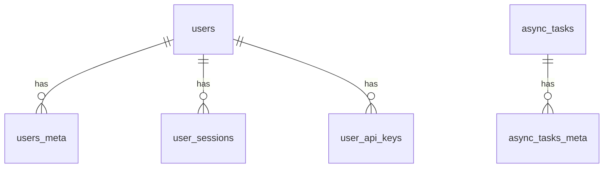

# Mut DB Schema

SQL migrations live in [`sql/`](sql) as `<version>_<description>.{up,down}.sql` pairs. Applied versions are tracked in the `migrations` table.

```bash
go run mut.go migrate up -c config.yml
```

Every table has a UUID `id` primary key. Tables suffixed `_meta` are key/value extensions (`key`, `value jsonb`) of their parent table. All foreign keys use `ON DELETE CASCADE`. Timestamps default to `CURRENT_TIMESTAMP AT TIME ZONE 'UTC'` (shown as `now() UTC`).

## Identity

### `users`

| Column | Type | Nullable | Default | Notes |
|---|---|---|---|---|
| `id` | UUID | no |  | primary key |
| `name` | VARCHAR(60) | no |  |  |
| `email` | VARCHAR(60) | no |  | unique |
| `pwd_hash` | VARCHAR(200) | no |  |  |
| `role` | VARCHAR(20) | no | `'regular'` |  |
| `is_active` | BOOLEAN | yes | `true` |  |
| `last_login_at` | TIMESTAMP | yes |  |  |
| `language` | VARCHAR(20) | no | `'en'` |  |
| `theme` | VARCHAR(20) | no | `'default'` |  |
| `created_at` | TIMESTAMP | yes | `now() UTC` |  |
| `updated_at` | TIMESTAMP | yes | `now() UTC` |  |

- Index: `idx_users_email` on `(email)`

### `users_meta`

| Column | Type | Nullable | Default | Notes |
|---|---|---|---|---|
| `id` | UUID | no |  | primary key |
| `user_id` | UUID | no |  | → `users.id` (cascade) |
| `key` | VARCHAR(60) | no |  |  |
| `value` | JSONB | yes |  |  |
| `created_at` | TIMESTAMP | yes | `now() UTC` |  |
| `updated_at` | TIMESTAMP | yes | `now() UTC` |  |

- Unique: `(user_id, key)`
- Index: `idx_users_meta_user_id_key` on `(user_id, key)`

### `user_sessions`

| Column | Type | Nullable | Default | Notes |
|---|---|---|---|---|
| `id` | UUID | no |  | primary key |
| `token` | VARCHAR(100) | no |  | unique |
| `user_id` | UUID | no |  | → `users.id` (cascade) |
| `ip_address` | VARCHAR(45) | yes |  |  |
| `user_agent` | VARCHAR(200) | yes |  |  |
| `expires_at` | TIMESTAMP | no |  |  |
| `created_at` | TIMESTAMP | yes | `now() UTC` |  |
| `updated_at` | TIMESTAMP | yes | `now() UTC` |  |

- Index: `idx_user_sessions_token` on `(token)`

### `user_api_keys`

| Column | Type | Nullable | Default | Notes |
|---|---|---|---|---|
| `id` | UUID | no |  | primary key |
| `user_id` | UUID | no |  | → `users.id` (cascade) |
| `name` | VARCHAR(60) | no |  |  |
| `token` | VARCHAR(100) | no |  | unique |
| `expires_at` | TIMESTAMP | yes |  |  |
| `created_at` | TIMESTAMP | yes | `now() UTC` |  |
| `updated_at` | TIMESTAMP | yes | `now() UTC` |  |

- Index: `idx_user_api_keys_token` on `(token)`

## Ops

### `async_tasks`

| Column | Type | Nullable | Default | Notes |
|---|---|---|---|---|
| `id` | UUID | no |  | primary key |
| `type` | VARCHAR(60) | no |  |  |
| `status` | VARCHAR(20) | no | `'pending'` |  |
| `payload` | JSONB | yes |  |  |
| `result` | JSONB | yes |  |  |
| `error` | JSONB | yes |  |  |
| `attempts` | INTEGER | no | `0` |  |
| `priority` | SMALLINT | no | `50` |  |
| `run_at` | TIMESTAMP | yes |  |  |
| `locked_at` | TIMESTAMP | yes |  |  |
| `completed_at` | TIMESTAMP | yes |  |  |
| `created_at` | TIMESTAMP | yes | `now() UTC` |  |
| `updated_at` | TIMESTAMP | yes | `now() UTC` |  |

- Index: `idx_async_tasks_status_priority_created_at` on `(status, priority DESC, created_at)`

### `async_tasks_meta`

| Column | Type | Nullable | Default | Notes |
|---|---|---|---|---|
| `id` | UUID | no |  | primary key |
| `async_task_id` | UUID | no |  | → `async_tasks.id` (cascade) |
| `key` | VARCHAR(60) | no |  |  |
| `value` | JSONB | yes |  |  |
| `created_at` | TIMESTAMP | yes | `now() UTC` |  |
| `updated_at` | TIMESTAMP | yes | `now() UTC` |  |

- Unique: `(async_task_id, key)`

## Global

### `configs`

| Column | Type | Nullable | Default | Notes |
|---|---|---|---|---|
| `id` | UUID | no |  | primary key |
| `key` | VARCHAR(60) | no |  | unique |
| `value` | JSONB | yes |  |  |
| `created_at` | TIMESTAMP | yes | `now() UTC` |  |
| `updated_at` | TIMESTAMP | yes | `now() UTC` |  |

- Index: `idx_configs_key` on `(key)`

## Relationships


